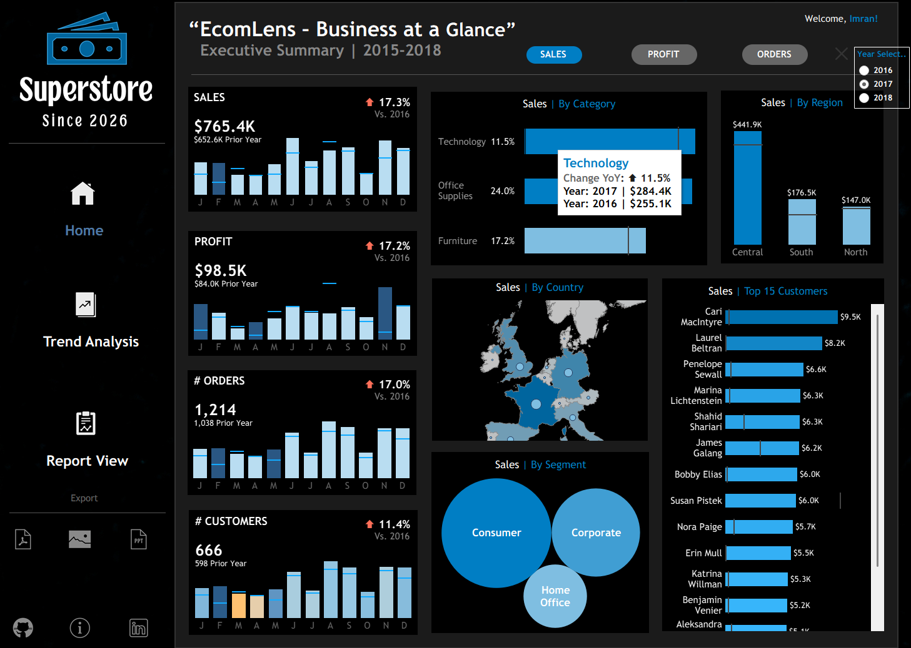
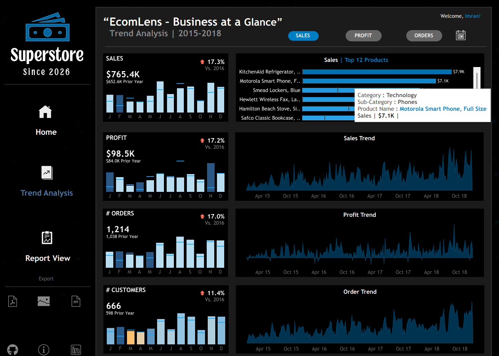
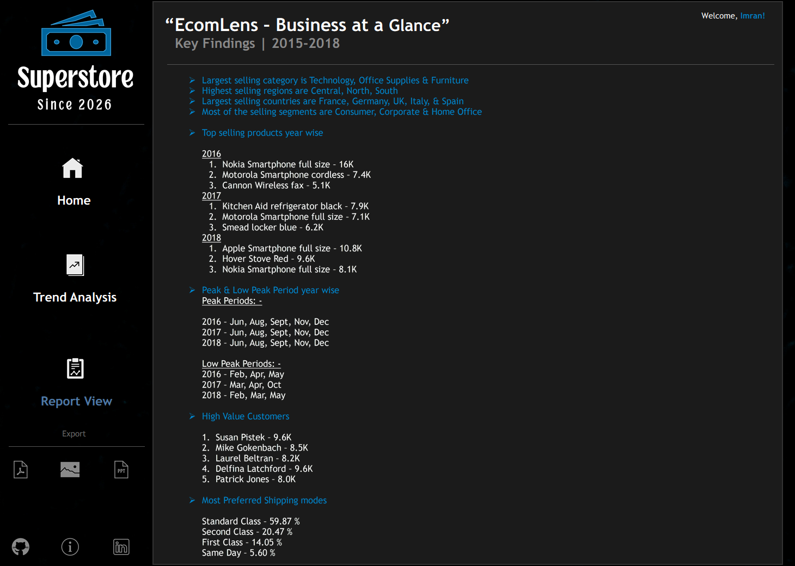

# EcomLens-Superstore-Sales-Dashboard

### Project Overview
EcomLens is a business intelligence project designed to present retail performance through interactive dashboards and visual reports.
The dashboard provides an executive summary of key performance indicators and a trend analysis view for exploring historical performance. Users can examine sales by category, region, country, and customer segment, as well as identify leading products and customers.
Dashboard period: 2015–2018

---

### Table of Contents
- [Problem Statement](#problem-statement)
- [Project Objectives](#project-objectives)
- [Dataset Description](#dataset-description)
- [Tools & Technologies](#tools--technologies)
- [Data Cleaning & Preparation](#data-cleaning--preparation)
- [Dashboard Features](#dashboard-features)
- [Dashboard Screenshots](#dashboard-screenshots)
- [Key Findings](#key-findings)
- [Business Recommendations](#business-recommendations)
- [Project Structure](#project-structure)
- [conclusion](#conclusion)
- [Author](#author)
---

### Problem Statement
Retail organizations need an effective way to understand sales performance, profitability, customer behavior, and product trends. Analyzing raw transaction data can make it difficult to identify patterns and areas for improvement.
This project transforms retail sales data into an interactive visual dashboard to help users monitor key metrics, compare business performance, and make data-driven decisions.

---

### Project Objectives
Analyze sales, profit, orders, and customer metrics.
Compare sales across product categories and geographic regions.
Identify top-performing products and customers.
Explore historical sales, profit, and order trends.
Present business performance through clear and interactive visualizations.
Evaluate the performance of different product categories and sub-categories.

---
### Dataset Description
This dataset contains retail sales transaction data for a superstore, covering customer orders, product categories, shipping details, geographical locations, and financial performance. It can be used to analyze sales trends, customer purchasing behavior, product performance, and profitability.
### Dataset Features
The dataset includes the following columns:
Row ID: Unique identifier for each record.
Order ID: Unique identifier for each customer order.
Order Date: Date when the order was placed.
Ship Date: Date when the order was shipped.
Ship Mode: Shipping method used, such as Standard Class, Second Class, First Class, and Same Day.
Customer ID: Unique identifier for each customer.
Customer Name: Name of the customer.
Segment: Customer segment, such as Consumer, Corporate, and Home Office.
City: City where the customer is located.
State: State or province associated with the order.
Country: Country where the order was placed.
Region: Geographical sales region.
Product ID: Unique identifier for each product.
Category: Main product category, such as Furniture, Office Supplies, and Technology.
Sub-Category: More specific classification of a product.
Product Name: Name of the product purchased.
Sales: Revenue generated from the sale.
Quantity: Number of units sold.
Discount: Discount applied to the transaction.
Profit: Profit or loss generated from the sale.

---

### Tools & Technologies
List only the tools used in the completed project.
Microsoft Excel — data inspection and preparation, if used
Power BI, Tableau, or Excel — dashboard development (specify the actual tool)

---

### Data Cleaning & Preparation
The data preparation process should include the following steps, where applicable:
Inspect column names, data types, and missing values.
Identify and handle duplicate records.
Correct date and numeric data types.
Validate sales, profit, quantity, and category values.
Verify calculations and year-over-year comparisons.
Prepare and save the cleaned dataset.
Validate the prepared data against the dashboard metrics.

---

### Dashboard Features
1. Executive Summary
Sales, profit, order, and customer KPIs
Year-over-year performance comparisons
Sales by product category
Sales by geographic region and country
Sales by customer segment
Top-customer analysis
2. Trend Analysis
Top products by sales
Sales trend over time
Profit trend over time
Order trend over time
Monthly performance comparisons
3. Interactive Exploration
Year-based filtering
Category and geographic comparisons
Customer and product performance analysis
---

### Dashboard Screenshots

- **Page 1 – Business at a Glance:** Provides an overview of key KPIs, sales, profit, customer segments, and regional performance.

- **Page 2 – Trend Analysis:** Highlights sales and profit trends, order patterns, and top-performing products over time.

- **Page 3 – Key Findings:** Summarizes major business insights, sales seasonality, customer performance, and shipping preferences.


### Key Findings

### 📈 Sales & Profit Performance
- **Total Sales:** `$765.4K`
- **Total Profit:** `$98.5K`
- **Total Orders:** `1,214`
- **Total Customers:** `666`
- **Sales Growth:** **17.3%** compared with 2016.
- **Profit Growth:** **17.2%** compared with 2016.
- **Order Growth:** **17.0%** compared with 2016.
- **Customer Growth:** **11.4%** compared with 2016.

### 🛍️ Product Category & Regional Analysis
- **Leading Categories:** Technology, Office Supplies, and Furniture.
- **Top Sales Regions:** Central, North, and South.
- **Leading Countries:** France, Germany, United Kingdom, Italy, and Spain.

### 🏆 Top-Selling Products by Year
- **2016:** Nokia Smartphone Full Size, Motorola Smartphone Cordless, Canon Wireless Fax.
- **2017:** KitchenAid Refrigerator Black, Motorola Smartphone Full Size, Smead Locker Blue.
- **2018:** Apple Smartphone Full Size, Hoover Stove Red, Nokia Smartphone Full Size.

### 👥 Customer Insights
- **Largest Customer Segment:** Consumer.
- **Other Key Segments:** Corporate and Home Office.
- **High-Value Customers:**
  - Susan Pistek — **$9.6K**
  - Mike Gokenbach — **$8.5K**
  - Laurel Beltran — **$8.2K**
  - Delfina Latchford — **$9.6K**
  - Patrick Jones — **$8.0K**

### 📅 Sales Seasonality
- **Peak Sales Months:** June, August, September, November, and December.
- **Lower-Performing Months:**
  - **2016:** February, April, and May.
  - **2017:** March, April, and October.
  - **2018:** February, March, and May.
- **Business Insight:** Use seasonal trends to optimize inventory, plan promotions, and improve sales performance.

### 🚚 Shipping Preferences
- **Standard Class:** 59.87%
- **Second Class:** 20.47%
- **First Class:** 14.05%
- **Same Day:** 5.60%
**Key Finding:** Standard Class is the most preferred shipping method, accounting for nearly **60%** of shipping preferences.

### 💡 Key Takeaways
- 📈 **Strong Business Growth:** Sales, profit, and orders increased by approximately **17%** compared with 2016.
- 🛍️ **Product Performance:** Focus on Technology, Office Supplies, and Furniture.
- 👥 **Customer Retention:** Develop targeted marketing and loyalty programs for high-value customers.
- 📅 **Seasonal Planning:** Align inventory and promotional campaigns with peak sales periods.
- 🚚 **Shipping Optimization:** Evaluate shipping efficiency and identify opportunities to improve delivery performance.
---
### Business Recommendations
- **Increase Sales:** Focus on top-performing products, categories, and regions to improve revenue and profitability.
- **Improve Customer Retention:** Develop targeted marketing campaigns and loyalty programs for high-value customers.
- **Optimize Inventory:** Align inventory levels and promotional activities with seasonal sales trends.
- **Enhance Shipping Efficiency:** Evaluate shipping costs and delivery performance to improve operational efficiency and customer satisfaction.
---

### Project Structure

```text
EcomLens/
│
├── README.md
│
├── screenshots/
│   ├── Tableau-Dashoard-PG-01.png
│   ├── Tableau-Dashoard-PG-02.png
│   └── Tableau-Dashoard-PG-03.png
│
├── dataset/
│   └── Superstore.csv
│
└── Tableau-Dashboard.twbx


### Conclusion
EcomLens demonstrates how retail transaction data can be organized into a business intelligence dashboard for monitoring performance and exploring sales trends.
The project combines KPI reporting, product and customer analysis, geographic comparisons, and historical trends to support clearer business understanding and make informed strategic decisions.

### Future Improvements
Add interactive filters for more business dimensions.
Include profitability analysis by category and region.
Automate data preparation and refresh workflows.
Add a dedicated business insights report.
Publish a web-accessible dashboard where supported.
Include documented validation checks and reproducible analysis.


